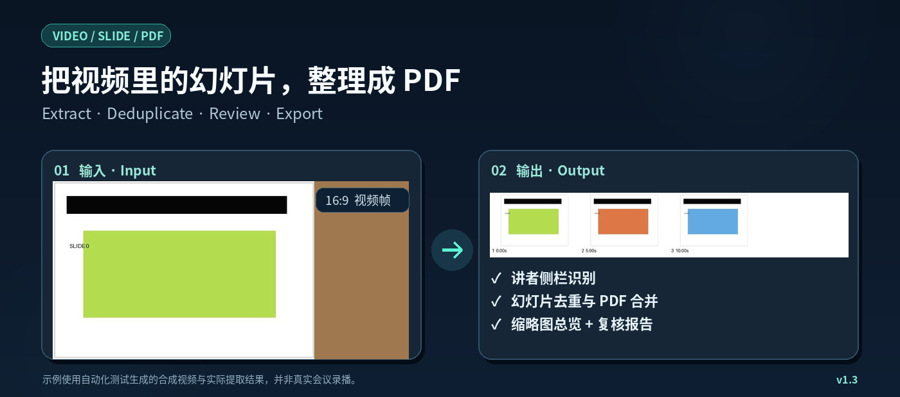

# Video to Slides PDF

**Turn lecture recordings, online courses and conference videos into organized, reviewable slide PDFs.** No more taking screenshots slide by slide.

[Read in Chinese](README.md)



*The example uses a synthetic test video, not a real conference recording.*

## What can it do?

| You have | What you can get |
| --- | --- |
| A video file on your computer | A PDF of candidate slides, with repeated frames reduced |
| A direct, accessible video file link | The same PDF output without manually downloading first |
| A long lecture or conference recording | Optional chapter PDFs, plus thumbnails for checking the results |
| A web video that requires sign-in | Video discovery and download **after you authorize access in the environment doing the work** |
| Several authorized sessions with predictable media URLs | Batch processing of the session IDs you explicitly provide, when that site permits it |
| A completed PDF | Optional Feishu upload; the existing specialized meeting workflow can also update its spreadsheets |

The default output stays on your computer: a **slide PDF**, a **thumbnail overview**, a **crop preview**, and a **review report**. It does not automatically delete the source video or upload files to the cloud.

## Get started in plain language

This is an **Agent Skill**, not a standalone website or a hosted video downloader. It works when installed in an AI agent that can run the included tools and access the video files or an authorized browser.

**For a local video**, ask your agent:

> "Please turn this lecture recording into a slide PDF. Remove repeated frames, keep the original video, and give me a thumbnail overview to check for missed slides."

**For a video on a sign-in website**, ask:

> "Please open this video site in a browser you can access. Tell me when I need to sign in there. Once the video is available to you, show me which videos you found and ask for confirmation before downloading and turning them into PDFs."

**For multiple sessions**, ask:

> "Check whether the videos I am allowed to access follow the same address pattern. If they do, use only the session IDs I supply. Show me the proposed list before downloading anything."

## Signing in: an important distinction

**Your personal browser login does not automatically sign an AI agent in.** An agent running in a cloud browser, local automation browser, or separate computer has its **own** session. You must authorize that environment separately.

1. **Agent has a supported interactive browser:** let it open the website, and complete the normal sign-in and verification steps **in the browser that it controls**. This grants access to that browser session, not to every tool or computer.
2. **Agent runs this Skill locally:** the optional browser tool opens a separate browser window. Sign in **in that window** before it captures playback requests. It does not silently use cookies from your normal Chrome or Edge profile.
3. **Agent cannot open an authorized browser:** download a permitted video yourself and provide the local file. On a trusted local computer, you can alternatively export a network-recording file (HAR) from your already authorized browser. **HAR files may contain live session credentials: never post them in chat, email, or a public repository.**

The agent must have access to the video or authorized session **in its actual execution environment**. A Skill cannot independently grant website access, inherit your login, or give a cloud agent access to local files. Only access and download content you have permission to use. File upload to a third-party service requires separate permission.

## Install

If your agent can install Skills from GitHub, point it to this repository and ask it to follow [SKILL.md](SKILL.md). Some agents support:

```bash
npx skills add andanluhui/meeting-slide-pdf-pipeline
```

Otherwise, download this repository as a ZIP and import the folder containing `SKILL.md` using your agent's own installation procedure. **Importing the Skill does not automatically install Python dependencies or grant browser access.** The repository is currently private; an authorized GitHub account is needed until it is published.

<details>
<summary><strong>Technical setup and examples (optional)</strong></summary>

Install Python 3.10+ dependencies from the repository folder:

```bash
python -m pip install -r scripts/requirements-core.txt
python scripts/video_to_pdf.py "lecture.mp4"
```

For optional browser-assisted capture, also install:

```bash
python -m pip install -r scripts/requirements-browser.txt
python -m playwright install chromium
python scripts/authenticated_video.py browser --url "https://example.org/videos" --dry-run
```

The browser mode opens a separate browser session for you to authorize. Other authorized-source options are documented in [the website video guide](references/authenticated-sources.md).

To inspect an existing local HAR without downloading:

```bash
python scripts/authenticated_video.py har --har "network.har" --dry-run
```

If media addresses share a *verified* pattern and you already have an authorized list of session IDs, see [batch processing instructions](references/authenticated-sources.md). This feature does not invent session IDs or bypass access checks.

</details>

## Understand the limits

- This tool cannot guarantee that every slide is captured or that every duplicate is removed. Review the thumbnail overview and the per-page quality flags.
- Not every player exposes an ordinary downloadable video file. Some sites use HLS/DASH streaming or DRM, which this source adapter does not handle.
- Real-world website flows vary. Site-specific support, including EADV, has **not** been validated on every current site version.
- Having a valid login does not automatically mean that downloading is permitted. Follow the website's rules and your content permissions.
- Installation, interactive browser access, and local script execution depend on your particular AI agent.

## More information

- [How website authorization and media discovery work](references/authenticated-sources.md)
- [Slide quality checks](references/quality-v12.md)
- [Original advanced meeting/Feishu workflow](references/legacy-skill-guide.md)
- [Safety and privacy](SECURITY.md)
- [Skill instructions for an AI agent](SKILL.md)
