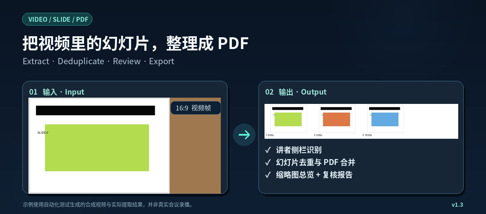

<h1 align="center">Video to Slides PDF</h1>

<p align="center"><strong>把会议录播、视频课程和演讲中的幻灯片，提取成可核对、可归档的 PDF。</strong></p>
<p align="center">Extract slides from lectures & recordings → deduplicate → export PDF → review & archive.</p>

<p align="center"></p>
<p align="center"><sub>图中是合成测试视频及实际处理结果，仅展示能力，不包含真实会议资料。</sub></p>

<p align="center">
  <a href="#quick-start">🚀 快速开始</a> ·
  <a href="#features">✨ 核心功能</a> ·
  <a href="#web-video">🔐 登录网站视频</a> ·
  <a href="#install-skill">📦 安装 Skill</a> ·
  <a href="#guide">📖 详细指南</a>
</p>

> **核心思路：先生成本地 PDF，再按需要上传。** 普通视频处理不依赖飞书、会议议程或登录凭证；只有访问受保护网页、上传云端时才需要额外授权和配置。

<a id="features"></a>
## ✨ 能做什么？

| 视频来源 | 内容整理 | 输出与扩展 |
| :--- | :--- | :--- |
| 📁 本地 MP4 / MOV 等视频 | ✂️ 去黑边、保守识别讲者侧栏 | 📄 按时间顺序生成 PDF |
| 🔗 可访问的 HTTP(S) 视频直链 | 🧩 相似页面去重、场景变化补帧 | 🖼️ 全量缩略图与裁剪预览 |
| 🔐 正常登录后的网页视频请求（HAR / 浏览器） | 🔎 标记疑似短页、模糊/空白候选页供复核 | 🗂️ 按指定时间点拆分章节 PDF |
| 📚 多个已授权会议视频 | 🧭 视觉变化生成*低置信度*章节建议 | ☁️ 可选上传飞书；旧版议程匹配与表格回填 |

**适合**：课程录屏整理、学术讲座幻灯片归档、多讲者会议回放、团队内部知识库建设。

**当前边界**：不是通用视频下载器；不绕过登录、DRM，也不保证所有网页播放器都能提取视频。启发式抽帧无法保证零漏页，正式归档前请复核。

<a id="quick-start"></a>
## 🚀 Quick start · 3 步开始

需要 **Python 3.10+**。从仓库下载源码（或使用 Git 克隆）并在仓库根目录执行：

```bash
# 1. 获取项目代码
git clone https://github.com/andanluhui/meeting-slide-pdf-pipeline.git
cd meeting-slide-pdf-pipeline

# 2. 安装视频处理依赖
python -m pip install -r scripts/requirements-core.txt

# 3. 本地视频 → PDF
python scripts/video_to_pdf.py "lecture.mp4"
```

> 当前仓库是 **Private**：克隆/安装需要账号已获得访问权限。公开发布后，他人才能免授权获取源码。Windows 可将 `python` 改为 `py`。

运行完成后，在**当前文件夹**得到：

```text
lecture-slides.pdf           ← 去重后的幻灯片
lecture-slides-contact.jpg   ← 缩略图总览（长视频可分多张）
lecture-slides-layout.jpg    ← 裁剪范围预览
lecture-slides.json          ← 页时间戳与复核标记
```

默认**不修改/删除源视频，不覆盖已有结果，也不自动上传云端**。

<a id="usage"></a>
## 🧩 3 个常见使用场景

**① 本地讲座 / 公开视频直链**

```bash
python scripts/video_to_pdf.py "./lecture.mp4"
python scripts/video_to_pdf.py "https://example.org/lecture.mp4" --output "lecture.pdf"
```

**② 长会议录播，需要章节 PDF**

```bash
python scripts/video_to_pdf.py "./conference.mp4" --chapters examples/chapters.example.json
```

也可以用 `--auto-chapters` 获取视觉变化提示，但**不是**准确的议程/讲者识别。复杂画面可用 `--layout full` 避免自动裁剪，或用 `--crop 0,0,0.78,1` 手动选择幻灯片区域。

**③ 登录后才看得到的视频（如 EADV 类型的网站）**

<a id="web-video"></a>
使用你已获授权的账号正常登录并播放，导出浏览器 DevTools **Network → HAR**。先查看发现的视频域名：

```bash
python scripts/authenticated_video.py har --har "network.har" --dry-run
```

确认媒体域名后，再明确指定允许下载的主机：

```bash
python scripts/authenticated_video.py har --har "network.har" \
  --allow-host media.example.org --out "./video-jobs"
```

如果不想导出 HAR，也支持 **Playwright 独立浏览器登录并捕获播放请求**，详见 [授权网页视频指南](references/authenticated-sources.md)。**真实 EADV 网站尚未实测**，部分播放平台可能需要专用适配器；HLS/DASH/DRM 不在当前支持范围。

> ⚠️ **HAR、浏览器 Profile 可能包含 Cookie、Authorization 和签名 URL。不要发给同事、上传 GitHub 或交给公开服务。**

<a id="install-skill"></a>
## 📦 安装为 Agent Skill

如果希望让 Codex 等支持 Skills 的 Agent 直接使用本仓库，提供两种入口：

**方式 A · Agent Skills CLI（可选，需 Node.js）**

```bash
npx skills add andanluhui/meeting-slide-pdf-pipeline
```

CLI 会引导选择可用的 Agent 和安装范围；私有仓库需要本机已配置 GitHub 认证。这是第三方 Agent Skills CLI，**不是 ChatGPT 网页版的一键安装按钮**。安装 Skill 后，执行视频处理仍需安装上面的 Python 依赖。

**方式 B · 手动安装**

下载仓库 ZIP，把包含 `SKILL.md` 的整个文件夹放入所用 Agent 的 Skills 目录，然后按照该 Agent 的安装/重载说明操作。也可把仓库链接交给支持 GitHub 安装的 Codex `$skill-installer`。

<a id="guide"></a>
## 📖 按需使用高级能力

| 你想做的事 | 入口 |
| :--- | :--- |
| 限制自动裁剪、提高采样频率、检查短页和误判 | [质量检查与参数说明](references/quality-v12.md) |
| 登录后从网页请求批量发现视频、续传下载 | [授权网页视频指南](references/authenticated-sources.md) |
| 把 PDF 上传飞书（不修改任何表格） | `python scripts/upload_pdf.py "lecture-slides.pdf" --dry-run`，参见 [SKILL.md](SKILL.md) |
| 按既有议程自动分段、批量上传、飞书表格回填 | [旧版会议批处理指南](references/legacy-skill-guide.md) |
| 处理个人凭证、临时视频及归档资料 | [安全与隐私说明](SECURITY.md) |

<details>
<summary><strong>环境说明、验证和常见问题</strong></summary>

- **平台**：基础流程使用 Python 3.10+、PyMuPDF、Pillow、NumPy、Requests 和 FFmpeg（通过 `imageio-ffmpeg`）。适用于 Windows、macOS、Linux 的常规 Python 环境；具体设备与网站仍需验证。
- **如何确认结果完整？** 查看所有 `*-contact*.jpg`、`*-layout.jpg` 和 `*-slides.json` 的 `quality.alerts` / `review_flags`，必要时调整采样和裁剪后重跑。
- **为什么视频链接不能直接用？** 播放器网页地址 ≠ 可下载的视频字节 URL。已授权网页可考虑 HAR 或浏览器模式；DRM 不支持。
- **会覆盖原 PDF 吗？** 默认拒绝覆盖；仅在你明确指定 `--overwrite` 时覆盖。
- **质量如何验证？** 已有针对合成视频、短暂幻灯片、讲者侧栏、直链与授权下载的自动化测试；真实 EADV 登录页尚未实测。

```bash
python -m unittest discover -s tests -v
python scripts/video_to_pdf.py --help
python scripts/authenticated_video.py --help
```

</details>

---

**项目定位**：通用、离线优先、可复核的视频转幻灯片 PDF Skill。欢迎在获得代码发布授权后用于团队协作；源视频、账号凭证与生成的 PDF 不应随代码公开。
